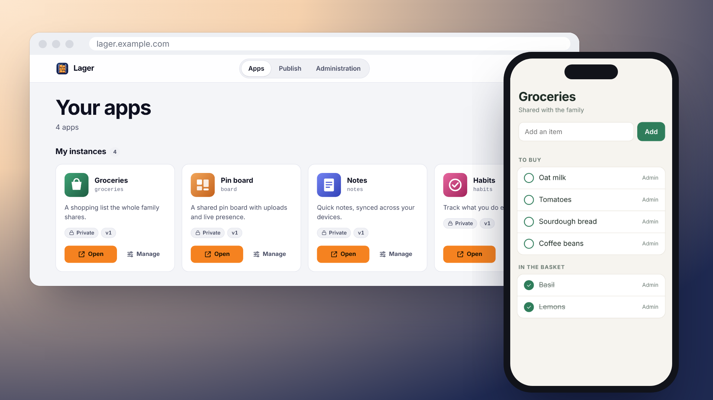

<p align="center">
  
</p>

<h1 align="center">Lager</h1>

<p align="center">
  <strong>The only two apps you'll ever need: Claude + Lager.</strong><br>
  Claude builds the app. Lager runs it on your own server, keeps its data and lets you share it with anyone.
</p>

<p align="center">
  <a href="#quick-start">Quick start</a> •
  <a href="docs/README.md">Documentation</a> •
  <a href="CONTRIBUTING.md">Contributing</a> •
  <a href="https://github.com/dm807cam/lager/discussions">Discussions</a> •
  <a href="https://github.com/dm807cam/lager/issues">Issues</a>
  <br><br>
  <a href="https://github.com/dm807cam/lager/actions/workflows/ci.yml"></a>
  <a href="LICENSE"></a>
  <a href="https://github.com/dm807cam/lager/pkgs/container/lager"></a>
  
  <a href="CONTRIBUTING.md"></a>
</p>

<p align="center">
  
</p>

---

Ask Claude for a shopping list your family shares, a booking sheet for your club or a tracker for your plants, and Claude builds it in a minute. But the result stays inside a chat. To use it on your phone or share it with someone who has no Claude account, you would normally have to host it yourself: a server, a container, a database, a domain.

**Lager removes that step.** Connect your Lager server to Claude once. From then on Claude publishes every app it builds straight to your server: with its own address, its own data, versions you can roll back, and an icon on your home screen. The people you share it with need only a browser.

## Why Lager? 🤩

- 🚀 **From prompt to app in one step.** Claude deploys through Lager's MCP connector. You get a link such as `groceries.apps.example.com`, not a file to download.
- 💾 **Data that stays.** Every app instance has its own document database with live updates, plus file uploads, so the app keeps its state across devices and people.
- 👪 **Share with anyone.** Share one instance so everyone works in the same data, or hand out separate copies of the app. Your family and friends do not need an AI subscription.
- ⏪ **Versions and rollback.** Every deploy is a numbered version. Lager takes a snapshot of the data before the active version changes, so you can always go back.
- 🧠 **Bring your own model.** Apps that call `claude.complete()` use a model you connect: Anthropic, OpenAI, OpenRouter, Mistral, a local Ollama, or any OpenAI-compatible server. You set the limits per person.
- 📱 **Feels like a real app.** Icons, theme colours and home-screen install for every app, in light and dark mode.
- 🔒 **Yours.** One Node.js process, SQLite and a data directory. No other services and no telemetry: the server only contacts the outside world when you set up mail or connect a model.
- 🌍 **Multilingual.** The interface is available in English, German, French and Spanish, and [adding a language](CONTRIBUTING.md#translations) takes one file.

## How it works

```
 You ──"build me a shared groceries list"──▶ Claude
                                               │  deploy_app (MCP)
                                               ▼
                                      ┌─────────────────┐
                                      │      Lager      │  versions, data, sharing,
                                      │  (your server)  │  icons, custom domains
                                      └────────┬────────┘
                                               │  https://groceries.apps.example.com
                       ┌───────────────────────┼───────────────────────┐
                       ▼                       ▼                       ▼
                   your phone             your laptop        a friend without Claude
```

Apps are ordinary Claude artifacts: a single HTML file. Instead of the browser's local storage they keep data through the same `claude.use("db")` interface artifacts use on claude.ai, and Lager provides it. So artifacts you already have can usually move to Lager with few changes, and Claude can do the move for you.

## Quick start

You need Docker with Compose, a domain, and a reverse proxy that terminates TLS. Lager needs two host names: one for the platform (`lager.example.com`) and a wildcard for the apps (`*.apps.example.com`).

```sh
git clone https://github.com/dm807cam/lager.git && cd lager
cp .env.example .env    # set LAGER_PUBLIC_URL, LAGER_APPS_DOMAIN and the first admin account
docker compose up -d --build
```

Then open `LAGER_PUBLIC_URL`, sign in and copy the connector address from the dashboard.

- **Reverse proxy, wildcard certificate, published images:** [Installation](docs/installation.md)
- **Just trying it?** Run it on your own machine without DNS or certificates: [Running from source](docs/installation.md#running-from-source)

### Connect Claude

| Client | How |
| --- | --- |
| claude.ai and Claude Desktop | Settings → Connectors → add a custom connector with `https://lager.example.com/mcp` |
| Claude Code | `claude mcp add --transport http lager https://lager.example.com/mcp` |

Then ask Claude to build something, for example *"Build a shared groceries list for my family and put it on Lager."* Details, API tokens and the optional Lager skill: [Connecting Claude](docs/connecting-claude.md).

## Features

| | |
| --- | --- |
| **Apps** | Own subdomain per instance, numbered versions with rollback, notes per deploy, icons and descriptions, home-screen install, custom domains |
| **Data** | Document database with live updates and access rules, file uploads, realtime rooms with presence, pages that save themselves, file downloads, snapshots, NDJSON export and import |
| **People** | Several accounts with roles (administrator, publisher, user), invitations, open or closed registration, groups, four access levels per instance, public instances |
| **Interfaces** | Browser dashboard, REST API, MCP endpoint with OAuth or API tokens |
| **AI** | `claude.complete()` routed to the providers you connect, AI groups with their own model and hourly limit per person, keys stored encrypted |
| **Operations** | Single process, SQLite, one data directory, online backup command, trash with retention, multi-architecture Docker images |

What Lager deliberately does not do (no single sign-on, no built-in TLS, no replication, …) is listed under [Limits](docs/limits.md#what-lager-cannot-do).

## Documentation

All documentation lives in [`docs/`](docs/README.md):
[Installation](docs/installation.md) ·
[Connecting Claude](docs/connecting-claude.md) ·
[Building apps](docs/building-apps.md) ·
[Bring your own model](docs/ai-models.md) ·
[Users and sharing](docs/users-and-sharing.md) ·
[Custom domains](docs/custom-domains.md) ·
[Data, backup and operations](docs/data-and-backup.md) ·
[Limits](docs/limits.md) ·
[Languages and appearance](docs/languages-and-appearance.md)

## Join in 👋

Lager is young, and there is room to shape it. Writing code is only one of many ways to help:

- 🌍 **Translate** the interface into your language. One file, and the tests check it for you. [How to add a language](CONTRIBUTING.md#translations)
- 🧩 **Share an example app** that shows what Lager can do. [Example apps](CONTRIBUTING.md#example-apps)
- 🐛 **Report a bug** or **suggest an idea** in the [issue tracker](https://github.com/dm807cam/lager/issues/new/choose).
- 📖 **Improve the documentation.** If something confused you, it will confuse the next person too.
- 👩‍💻 **Write code.** Start with a [good first issue](https://github.com/dm807cam/lager/labels/good%20first%20issue).
- 💬 **Help others** in [Discussions](https://github.com/dm807cam/lager/discussions).

The [contributing guide](CONTRIBUTING.md) explains the development setup, the tests and how a pull request gets merged. Everyone taking part agrees to the [Code of Conduct](CODE_OF_CONDUCT.md).

### Development in 30 seconds

```sh
git clone https://github.com/dm807cam/lager.git && cd lager
npm ci
cp .env.example .env && set -a && . ./.env && set +a
LAGER_DATA_DIR=./data npm run dev    # platform at http://localhost:8080, apps at http://<slug>.apps.localhost:8080
npm test                             # about 900 tests, under a minute
```

## Security

Please do not report security problems in public issues. Read the [security policy](SECURITY.md) to learn how to report a vulnerability privately.

## License and trademarks

Lager is free software, licensed under the [GNU Affero General Public License v3.0 or later](LICENSE). You may use, study, change and share it. If you run a modified version that other people use over a network, the AGPL requires you to offer them its source code.

Lager is an independent project and is not affiliated with or endorsed by Anthropic. Claude is a trademark of Anthropic.
